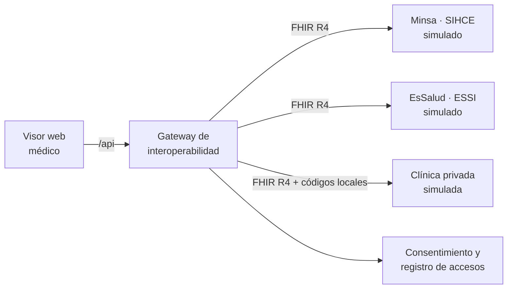

# interop-hc-peru

**PMV1 · Visor de historia clínica unificada**
Curso TE111U Innovación y Gestión Tecnológica (UNI-FIIS) · Grupo C

Prototipo que simula la **interoperabilidad de la historia clínica en el Perú**: un paciente atendido en el
Minsa, en EsSalud y en una clínica privada tiene tres historiales aislados. El visor los unifica a partir del DNI,
avisa al médico si un examen ya se hizo en otro establecimiento y respeta el consentimiento del paciente.

> **Todos los datos son ficticios.** Los pacientes (DNI 90000001 en adelante) y los sistemas son simulados.
> Las historias clínicas reales son datos sensibles protegidos por la Ley N.° 29733 y no se usan.

## El problema y la solución

- **Problema:** al atenderse en más de un establecimiento, los antecedentes no viajan con el paciente: el médico
  los reconstruye de memoria o repite exámenes, y el paciente carga sus propios resultados.
- **Solución elegida (terna de soluciones, mayor puntaje):** visor de resumen del paciente sobre FHIR con alerta de
  exámenes duplicados. El carné con consentimiento del paciente se integra como módulo del visor.

## Qué hace el PMV1

| Función | Dónde |
|---|---|
| Tres sistemas simulados (Minsa · SIHCE, EsSalud · ESSI, Clínica privada), cada uno con su API FHIR R4 y sus propios IDs | `app/systems.py` |
| Capa de interoperabilidad: consulta los tres sistemas por HTTP, normaliza y unifica por DNI | `app/gateway.py` |
| Normalización de códigos: la clínica usa códigos propios que se traducen a LOINC | `app/config.py`, `app/gateway.py` |
| Unificación de medicamentos, alergias y condiciones, con el establecimiento de origen | `app/gateway.py` |
| Alerta de exámenes repetidos entre establecimientos y evaluación al **pedir** un examen | `app/alerts.py` |
| Consentimiento del paciente y registro de quién consultó el historial | `app/consent.py` |
| Tolerancia a fallos: si un sistema cae, el visor avisa que el historial está incompleto | `app/gateway.py`, interfaz |
| Visor web para el médico | `app/static/` |

## Arquitectura



Los sistemas simulados viven en el mismo proceso, pero el gateway **no accede a sus datos directamente**: los consulta
mediante peticiones HTTP/FHIR (`/sistemas/{minsa|essalud|clinica}/fhir/...`), igual que lo haría con sistemas reales.
Esos endpoints también se pueden abrir en el navegador, por ejemplo `/sistemas/minsa/fhir/metadata`.

## Cómo ejecutarlo

Requiere Python 3.11 o superior.

```bash
python -m venv .venv
# Windows: .venv\Scripts\activate    ·    Linux/macOS: source .venv/bin/activate
pip install -r requirements.txt
python -m uvicorn app.main:app --reload
```

Abrir <http://localhost:8000>. La documentación interactiva de la API está en <http://localhost:8000/docs>.

Pruebas automáticas:

```bash
python -m pytest
```

## Guion de demostración

| DNI | Qué muestra |
|---|---|
| `90000001` | Paciente en Minsa y EsSalud con **HbA1c y glucosa repetidas**; la alergia solo está registrada en un sistema |
| `90000002` | **ECG repetido** entre Minsa y clínica; pedir un ECG dispara la alerta de duplicado |
| `90000003` | Referencia del Minsa a EsSalud: radiografía de tórax y hemoglobina repetidas |
| `90000004` | Caso de control: un solo sistema, sin duplicados |
| `90000005` | Tres sistemas y **sin consentimiento**: el acceso se bloquea hasta que el paciente autoriza |
| `90000006` | La clínica envía los exámenes con **códigos locales** y el gateway los normaliza a LOINC |

Para ver la tolerancia a fallos, haga clic en el nombre de un sistema en la cabecera para simular su caída.

## Estructura

```
app/
  main.py        API del visor y arranque
  gateway.py     capa de interoperabilidad
  systems.py     sistemas simulados (API FHIR)
  synthetic.py   generador de pacientes ficticios
  alerts.py      detección de duplicados
  consent.py     consentimiento y accesos
  fhir.py        constructores de recursos FHIR
  config.py      catálogo de exámenes y códigos
  static/        interfaz web
tests/           pruebas automáticas
```

## Alcance y limitaciones del PMV1

- Usa recursos FHIR R4 básicos (`Patient`, `Observation`, `DiagnosticReport`, `MedicationStatement`,
  `AllergyIntolerance`, `Condition`). **Aún no se valida contra el perfil `HL7.FHIR.PE.COREPE` del Minsa.**
- El URI del DNI (`https://www.reniec.gob.pe/dni`) es de ejemplo.
- Las ventanas de días para considerar duplicado un examen son parámetros de demostración, no criterios clínicos.
- Autenticación y autorización reales no están implementadas: el consentimiento y el médico son simulados.
- Los datos viven en memoria y se regeneran al iniciar; las fechas son relativas al día de ejecución.

## Próximos pasos (PMV2)

1. Validar los recursos contra el perfil peruano de FHIR del Minsa.
2. Carné digital del paciente con QR y consentimiento por establecimiento.
3. Modo sin conexión con sincronización diferida para establecimientos con poca conectividad.
4. Validar el flujo con un médico y con pacientes reales (entrevistas de usabilidad).
